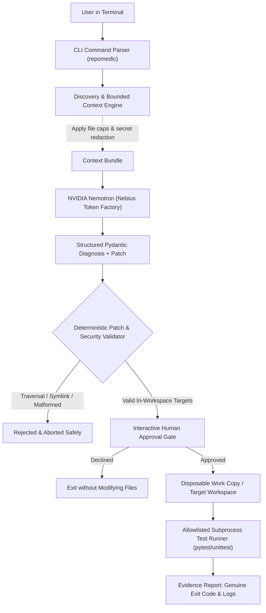

<div align="center">

# 🩺 RepoMedic CLI

**A Safe, Evidence-Based Terminal Agent for Repository Diagnosis and Verified Repair**

[](LICENSE)
[](https://python.org)
[](https://nebiusglobalaihackathon.devpost.com/)
[](https://nebiusglobalaihackathon.devpost.com/)
[](https://nebius.com/services/token-factory/nemotron)
[](https://docs.tokenfactory.nebius.com/quickstart)

*RepoMedic bridges the gap between chat-based LLM suggestions and reproducible software engineering repairs.*

</div>

---

## 📌 Executive Summary

When a build fails, an import breaks, or a regression test crashes, developers often copy-paste errors into an AI chat window. While chat models can explain syntax errors, **conversational advice cannot prove that a patch works in an actual repository**. Moreover, granting an autonomous agent unbounded filesystem access or arbitrary shell execution introduces severe security and stability risks.

**RepoMedic CLI** is a human-in-the-loop terminal coding agent designed for safe repository repair:
1. **Bounded Context**: Ingests only relevant project manifests, targeted source files, and truncated error logs—automatically redacting credentials and API keys.
2. **NVIDIA Nemotron via Nebius Token Factory**: Generates structured, schema-validated diagnoses and unified diff patches via live OpenAI-compatible inference.
3. **Deterministic Security Boundary**: Validates every patch target before disk operations, strictly rejecting parent traversal (`..`), absolute paths, repository metadata (`.git`), and symlink escapes.
4. **Human Approval Gate**: Interactive preview of unified diffs requiring explicit confirmation before any file modification.
5. **Verified Evidence**: Executes allowlisted test profiles (`pytest`, `unittest`) in disposable copies with strict timeouts, reporting real subprocess exit codes instead of trusting an LLM's claim of success.

---

## 🏗️ Architecture & Data Flow



---

## 🌟 Core Features

- **Runtime Nebius Token Factory Integration**: Direct runtime connection to NVIDIA Nemotron models using Nebius's OpenAI-compatible API endpoint.
- **OWASP-Compliant Command Execution**: Safe subprocess execution with argument arrays (`shell=False`), eliminating shell-string interpolation risks.
- **Traversal Defense**: Strict path resolution guaranteeing that model-authored patches cannot escape the repository root.
- **Heuristic Secret Redaction**: Masks Bearer tokens, GitHub personal access tokens, and API keys before repository context leaves the local machine.
- **Deterministic Test Fixtures**: Ships with a reproducible failing fixture (`fixtures/broken_sample_project/`) for immediate testing and verification without requiring live API quotas.
- **Terminal UI**: Colored diff rendering, status tables, and diagnostic panels powered by Typer and Rich.

---

## 🚀 Quickstart & Setup

### Prerequisites
- **Python**: 3.11 or newer (tested on Python 3.11, 3.12, and 3.13)
- **Git**: Installed and available in PATH
- **Nebius Token Factory API Key**: Obtainable from [Nebius Token Factory](https://tokenfactory.nebius.com)

### 1. Installation

Clone the repository and set up a local virtual environment:

**On Linux / macOS:**
```bash
git clone https://github.com/Dev-gautam-roy/coding-cli.git repomedic
cd repomedic
python3 -m venv .venv
source .venv/bin/activate
pip install --upgrade pip
pip install -e ".[dev]"
```

**On Windows (PowerShell):**
```powershell
git clone https://github.com/Dev-gautam-roy/coding-cli.git repomedic
cd repomedic
python -m venv .venv
.\.venv\Scripts\Activate.ps1
python -m pip install --upgrade pip
python -m pip install -e ".[dev]"
```

### 2. Configure Credentials

Copy `.env.example` to `.env` and provide your Nebius Token Factory credentials:

```bash
cp .env.example .env
```

Edit `.env`:
```env
# Nebius Token Factory API Key
NEBIUS_API_KEY=your_token_factory_api_key_here

# OpenAI-Compatible Base URL
NEBIUS_BASE_URL=https://api.tokenfactory.us-central1.nebius.com/v1/

# NVIDIA Nemotron Model Identifier
NEBIUS_MODEL=nvidia/Nemotron-3_5-Lightning
```

*(Note: `.env` is protected by `.gitignore` and is never committed to source control).*

---

## 💻 CLI Commands

RepoMedic provides a unified suite of developer commands:

### `repomedic doctor`
Validates local Python runtime, git installation, and Nebius Token Factory configuration.
```bash
repomedic doctor
```

### `repomedic inspect`
Inspects workspace structure, identifies project manifests, and enumerates candidate source files without modifying any files.
```bash
repomedic inspect ./fixtures/broken_sample_project
```

### `repomedic diagnose`
Collects bounded source context, optionally includes error logs, and queries NVIDIA Nemotron for root-cause analysis and a unified diff patch.
```bash
# Basic diagnosis
repomedic diagnose ./fixtures/broken_sample_project

# Diagnosis with specific error log and output artifact
repomedic diagnose ./fixtures/broken_sample_project --log ./artifacts/test.log --out ./artifacts/diagnosis.json
```

### `repomedic apply`
Validates that all patch paths remain inside the workspace, displays a unified diff preview, and requests explicit user confirmation before applying.
```bash
repomedic apply ./fixtures/broken_sample_project --patch ./fixtures/fix_calculator.patch
```

### `repomedic verify`
Executes an allowlisted test profile in the workspace and produces an evidence report with real subprocess exit codes.
```bash
repomedic verify ./fixtures/broken_sample_project --profile pytest
```

---

## 🧪 Test Suite & Acceptance Matrix

RepoMedic includes automated unit and regression tests covering all security boundaries, schema validations, and process runners:

```bash
pytest
```

### Verified Acceptance Matrix

| Test ID | Scenario | Verification Status |
|:---:|:---|:---:|
| **AT-01** | Known fixture contains repairable defect | **PASSED** (Diagnosed in `fixtures/broken_sample_project`) |
| **AT-02** | Model returns malformed patch or invalid hunk | **PASSED** (`test_patch_validator.py` rejects invalid hunks) |
| **AT-03** | Patch attempts path traversal (`../outside.txt`) | **PASSED** (`test_security.py` blocks escape) |
| **AT-04** | User declines patch approval | **PASSED** (Workspace remains unmodified on rejection) |
| **AT-05** | Approved patch fixes the fixture | **PASSED** (Verified exit code `0` on test suite rerun) |
| **AT-06** | Test runner process exceeds timeout | **PASSED** (`test_runner.py` reports `timed_out`) |
| **AT-07** | Secret leakage & credential protection | **PASSED** (`test_security.py` redacts API keys and tokens) |
| **AT-08** | Fresh checkout setup | **PASSED** (Clean install from `pyproject.toml`) |

---

## 🎬 End-to-End Walkthrough Demonstration

A self-contained demonstration script is included to reproduce the complete diagnosis, baseline failure, human approval, and test verification workflow:

```bash
python demo/app.py
```

### Demonstration Steps:
1. **Pre-flight Check**: Runs `repomedic doctor` to confirm toolchain readiness.
2. **Inspection**: Analyzes `fixtures/broken_sample_project` detecting manifests and Python source.
3. **Baseline Failure**: Runs `pytest` on the unpatched sample project, proving the failure (AssertionError on addition).
4. **Approval & Patch Application**: Previews the unified diff, passes security path validation, and applies the patch.
5. **Verified Resolution**: Re-runs `pytest`, confirming exit code `0` and passing test output.

---

## 🛡️ Security & Threat Model

| Threat | RepoMedic Mitigation |
|:---|:---|
| **Arbitrary Command Execution** | Model is never permitted to emit shell commands for execution; test execution is strictly restricted to allowlisted profiles (`pytest`, `unittest`) using `shell=False`. |
| **Path Traversal / Arbitrary File Overwrite** | Paths are canonicalized with `Path.resolve()` and tested with `relative_to(root)`. Any path containing `..`, absolute drives, or `.git` directories is rejected immediately. |
| **Secret Leakage to Remote LLM** | Known credential formats (GitHub PATs, AWS/GCP secrets, Bearer tokens, API keys) and sensitive file extensions (`.env`, `.pem`, `.key`, `id_rsa`) are stripped prior to inference. |
| **Silent / Hallucinated Fixes** | LLM self-assessments (*"I have fixed this"*) are disregarded; only genuine OS process exit codes (`returncode == 0`) are reported as verification evidence. |

---

## 📋 Hackathon Submission Alignment

- **Event**: Nebius × NVIDIA Global AI Hackathon
- **Track**: Coding and Agentic Engineering
- **Model Integration**: NVIDIA Nemotron (via Nebius Token Factory OpenAI-compatible API)
- **Open Source**: Publicly licensed under Apache 2.0
- **Reproducibility**: Pinned dependencies, reproducible failing fixture, and runnable local demo.

---

## 📄 License

This project is licensed under the Apache License, Version 2.0. See the [LICENSE](LICENSE) file for details.
