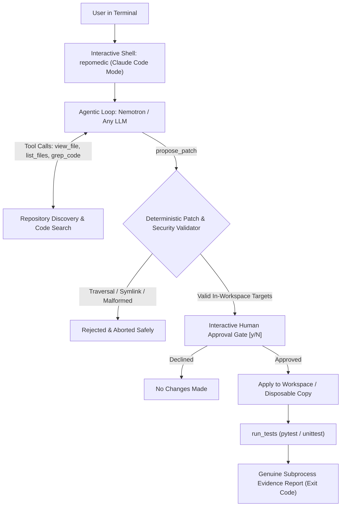

<div align="center">

# 🩺 RepoMedic CLI

**A Safe, Evidence-Based Terminal Agent for Repository Diagnosis and Verified Repair**  
*(Interactive Autonomous Coding Agent built like Claude Code)*

[](LICENSE)
[](https://python.org)
[](https://nebiusglobalaihackathon.devpost.com/)
[](https://nebiusglobalaihackathon.devpost.com/)
[](https://nebius.com/services/token-factory/nemotron)
[](https://docs.tokenfactory.nebius.com/quickstart)

*RepoMedic bridges the gap between chat-based LLM suggestions and reproducible software engineering repairs.*

</div>

---

## 📌 Executive Summary

When a build fails, an import breaks, or a regression test crashes, developers often copy-paste errors into an AI chat window. While chat models can explain syntax errors, **conversational advice cannot prove that a patch works in an actual repository**. Moreover, granting an autonomous agent unbounded filesystem access or arbitrary shell execution introduces severe security and stability risks.

**RepoMedic CLI** operates as a terminal-first, human-in-the-loop autonomous coding agent:
1. **Interactive Claude Code Interface**: Launch with a single command (`repomedic`), converse in natural language, and let the agent autonomously inspect files, search code, propose patches, and execute test suites.
2. **Autonomous Toolset**: Equipped with safe tools (`view_file`, `list_files`, `grep_code`, `propose_patch`, `run_tests`).
3. **Flexible Model Engine**: Works with **Nebius Token Factory** (NVIDIA Nemotron), **NVIDIA NIM** (free instant key without credit card), **OpenAI**, **Groq**, **OpenRouter**, or local endpoints (Ollama / vLLM).
4. **Deterministic Security Boundary**: Validates every patch target before disk operations, strictly rejecting parent traversal (`..`), absolute paths, repository metadata (`.git`), and symlink escapes.
5. **Human Approval Gate**: Interactive preview of color-coded unified diffs requiring explicit confirmation before any file modification.
6. **Verified Evidence**: Executes allowlisted test profiles (`pytest`, `unittest`) in disposable copies with strict timeouts, reporting real subprocess exit codes instead of trusting an LLM's claim of success.

---

## ⏱️ Current Status & Hackathon Implementation Timeline

> **Overall Progress: 6 / 7 Milestones Completed (~86%)**  
> `████████████████████████████████████░░░░░░`  
> *Target Submission Deadline: 30 October 2026 (10:00 AM PT / 10:30 PM IST)*

| Phase / Day | Focus & Deliverable | Exit Criterion | Status |
|:---|:---|:---|:---:|
| **Day 1** (Oct 24) | Repo foundation, multi-provider API client, schemas & base fixture | Live inference verified & sample fixture defined |  |
| **Day 2** (Oct 25) | CLI skeleton, project discovery, bounded context & secret redaction | Bounded context collected without secret leaks |  |
| **Day 3** (Oct 26) | Structured Pydantic diagnosis & deterministic patch validator | Traversal and malformed patches strictly blocked |  |
| **Day 4** (Oct 27) | Human approval gate, diff preview & safe test runner | Predefined test passes and exit code is reported |  |
| **Day 5** (Oct 28) | Security regression suite & cross-platform testing (Win/Linux) | 24/24 pytest suite passing cleanly |  |
| **Day 6** (Oct 29) | Public repository, Apache 2.0 license, full docs & automated demo | Clean clone works & demo script succeeds |  |
| **Day 7** (Oct 30) | Under 3-minute video demo, tool feedback & Devpost submission | Devpost submission completed before deadline |  |


---

## 🏗️ Architecture & Data Flow



---

## ⚡ Complete Guide: How to Use RepoMedic CLI

RepoMedic gives you **two ways to work**:
1. **Interactive Claude Code Mode** (Recommended): A live terminal assistant that listens to natural language and uses tools.
2. **Direct CLI Commands**: Scriptable, single-shot commands for CI/CD and pipeline automation.

---

### Part 1: Interactive Agent Mode (Claude Code Experience)

To start the interactive coding agent, simply run `repomedic` with **no arguments**:

```bash
repomedic
```
*(Or `python -m repomedic.cli` if you prefer direct module execution)*

#### The Interactive Prompt:
```text
RepoMedic v0.1.0 (Claude Code Mode)
cwd: C:\your-project | model: Nebius Token Factory (nvidia/Nemotron-3_5-Lightning)
Type your request naturally, or type /help, /doctor, /exit.

repomedic > 
```

#### What You Can Say in Interactive Mode:

* **Investigate and repair test failures:**
  ```text
  repomedic > find why tests in fixtures/broken_sample_project fail, fix it and verify
  ```
  *The agent will automatically list directory files, read the failing test, view `core.py`, detect the bug, propose a color-coded unified diff, ask for your confirmation, apply it upon approval, and re-run pytest to prove the fix.*

* **Explore an unfamiliar repository:**
  ```text
  repomedic > explain the architecture and file structure of this repo
  ```

* **Search codebase for symbols or errors:**
  ```text
  repomedic > search for where add and multiply are defined
  ```

* **Interactive Human Approval Gate:**
  Whenever the agent proposes changes to your code, it renders a syntax-highlighted diff and pauses:
  ```text
  Proposed Patch: Fix arithmetic calculation error in core.py
    1 --- a/src/calculator/core.py
    2 +++ b/src/calculator/core.py
    3 @@ -3,3 +3,3 @@
    4  def add(a: int, b: int) -> int:
    5 -    return a - b
    6 +    return a + b
  
  Apply this change? [y/N/e(dit)]: 
  ```

#### Built-in Slash Commands in Interactive Mode:
- `/doctor` — Run system and AI provider health checks
- `/clear` — Clear the terminal window
- `/help` — Display list of commands
- `/exit` — Quit the interactive session

---

### Part 2: Direct Scriptable CLI Commands

If you want to run specific subroutines without entering the interactive shell:

| Task | Command |
|:---|:---|
| **Health Check** | `repomedic doctor` |
| **Inspect Repo Structure** | `repomedic inspect ./path/to/repo` |
| **One-Shot Diagnosis** | `repomedic diagnose ./path/to/repo --log test.log --out fix.json` |
| **Apply Patch with Approval** | `repomedic apply ./path/to/repo --patch fix.patch` |
| **Verify Tests & Exit Code** | `repomedic verify ./path/to/repo --profile pytest` |

---

## 🚀 Quickstart & Setup (2-Minute Walkthrough)

### Prerequisites
- **Python**: 3.11 or newer (`python --version`)
- **Git**: Installed and available in PATH
- **Any AI API Key**: Nebius Token Factory, NVIDIA NIM, OpenAI, Groq, OpenRouter, or Local LLM.

---

### Step 1: Clone & Setup

#### 🐧 Linux / macOS:
```bash
git clone https://github.com/Dev-gautam-roy/coding-cli.git repomedic
cd repomedic
python3 -m venv .venv
source .venv/bin/activate
pip install --upgrade pip
pip install -e ".[dev]"
```

#### 🪟 Windows (PowerShell):
```powershell
git clone https://github.com/Dev-gautam-roy/coding-cli.git repomedic
cd repomedic
python -m venv .venv
.\.venv\Scripts\Activate.ps1
python -m pip install --upgrade pip
python -m pip install -e ".[dev]"
```

---

### Step 2: Configure Your API Key (Choose Any Provider)

Copy the configuration template:
```bash
# Linux / macOS
cp .env.example .env

# Windows PowerShell
Copy-Item .env.example .env
```

Open `.env` and set whichever key you have:

#### Option A: Nebius Token Factory (Official Hackathon Provider)
```env
NEBIUS_API_KEY=your_token_factory_key
NEBIUS_BASE_URL=https://api.tokenfactory.us-central1.nebius.com/v1/
NEBIUS_MODEL=nvidia/Nemotron-3_5-Lightning
```

#### Option B: NVIDIA NIM (Free instant key, no credit card required at [build.nvidia.com](https://build.nvidia.com))
```env
NVIDIA_API_KEY=nvapi-your_key_here
```

#### Option C: OpenAI
```env
OPENAI_API_KEY=sk-your_key_here
OPENAI_MODEL=gpt-4o-mini
```

#### Option D: Groq (Ultra-fast free tier at [console.groq.com](https://console.groq.com))
```env
GROQ_API_KEY=gsk_your_key_here
GROQ_MODEL=llama-3.3-70b-versatile
```

#### Option E: Local LLMs (Ollama / vLLM / LM Studio)
```env
LLM_API_KEY=dummy-token
LLM_BASE_URL=http://localhost:11434/v1/
LLM_MODEL=llama3.2
```

---

### Step 3: Run Doctor Health Check

```bash
repomedic doctor
```

Output confirms that your Python runtime, Git executable, and target AI provider are recognized and ready:
```text
+------------------------------+
| RepoMedic Environment Doctor |
+------------------------------+
                       System & Configuration Check                        
+-------------------------------------------------------------------------+
| Component         | Status     | Details                                |
|-------------------+------------+----------------------------------------|
| Python Runtime    | OK         | Python 3.13.2 (Supported)              |
| Git Executable    | OK         | C:\Program Files\Git\cmd\git.EXE       |
| Detected Provider | OK         | Nebius Token Factory (or NVIDIA NIM)   |
| API Key           | CONFIGURED | Key: nvap...7890                       |
| Base URL          | OK         | https://integrate.api.nvidia.com/v1/   |
| Configured Model  | OK         | nvidia/llama-3.1-nemotron-70b-instruct |
+-------------------------------------------------------------------------+
```

---

### Step 4: Run the Automated 5-Step Demo

To witness the entire repair lifecycle execute on the sample broken project:

```bash
python demo/app.py
```

---

## 🧪 Test Suite & Acceptance Matrix

RepoMedic includes automated unit and regression tests covering all security boundaries, multi-provider configuration, schema validations, and process runners:

```bash
pytest
```

### Verified Acceptance Matrix

| Test ID | Scenario | Verification Status |
|:---:|:---|:---:|
| **AT-01** | Known fixture contains repairable defect | **PASSED** (Diagnosed in `fixtures/broken_sample_project`) |
| **AT-02** | Model returns malformed patch or invalid hunk | **PASSED** (`test_patch_validator.py` rejects invalid hunks) |
| **AT-03** | Patch attempts path traversal (`../outside.txt`) | **PASSED** (`test_security.py` blocks escape) |
| **AT-04** | User declines patch approval | **PASSED** (Workspace remains unmodified on rejection) |
| **AT-05** | Approved patch fixes the fixture | **PASSED** (Verified exit code `0` on test suite rerun) |
| **AT-06** | Test runner process exceeds timeout | **PASSED** (`test_runner.py` reports `timed_out`) |
| **AT-07** | Secret leakage & credential protection | **PASSED** (`test_security.py` redacts API keys and tokens) |
| **AT-08** | Fresh checkout setup | **PASSED** (Clean install from `pyproject.toml`) |
| **AT-09** | Multi-Provider resolution (Nebius, NIM, OpenAI, Groq, Custom) | **PASSED** (`test_config.py` auto-detects providers) |

---

## 🛡️ Security & Threat Model

| Threat | RepoMedic Mitigation |
|:---|:---|
| **Arbitrary Command Execution** | Model is never permitted to emit arbitrary shell commands; test execution is strictly restricted to allowlisted profiles (`pytest`, `unittest`) using `shell=False`. |
| **Path Traversal / Arbitrary File Overwrite** | Paths are canonicalized with `Path.resolve()` and tested with `relative_to(root)`. Any path containing `..`, absolute drives, or `.git` directories is rejected immediately. |
| **Secret Leakage to Remote LLM** | Known credential formats (GitHub PATs, AWS/GCP secrets, Bearer tokens, API keys) and sensitive file extensions (`.env`, `.pem`, `.key`, `id_rsa`) are stripped prior to inference. |
| **Silent / Hallucinated Fixes** | LLM self-assessments (*"I have fixed this"*) are disregarded; only genuine OS process exit codes (`returncode == 0`) are reported as verification evidence. |

---

## 📋 Hackathon Submission Alignment

- **Event**: Nebius × NVIDIA Global AI Hackathon
- **Track**: Coding and Agentic Engineering
- **Model Integration**: NVIDIA Nemotron (via Nebius Token Factory or NVIDIA NIM) + Any OpenAI-compatible fallback
- **Open Source**: Publicly licensed under Apache 2.0
- **Reproducibility**: Pinned dependencies, reproducible failing fixture, and runnable local demo.

---

## 📄 License

This project is licensed under the Apache License, Version 2.0. See the [LICENSE](LICENSE) file for details.
